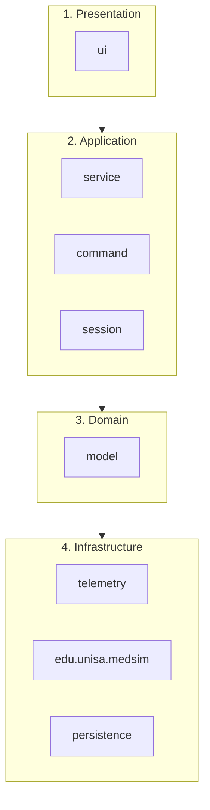

# Software Architecture

**Telerehab Session Manager**, Medical Software Engineering, a.y. 2026/27.
A JavaFX desktop application for clinicians to design rehabilitation protocols and run them
with simulated physiological telemetry (package `edu.unisa.medsim`).

This document describes the **planned** architecture and is updated at the end of each sprint.
Most classes named here are introduced during the sprints; at the Pre-Game only the packages
and the `edu.unisa.medsim` module exist. Story IDs refer to the atomic product backlog
(`docs/Telerehab_Product_Backlog.xlsx`), decision IDs to its "Decisions" sheet.

## 1. Technology

| Choice | Motivation |
| --- | --- |
| Java 17, Maven | Required by the provided simulator, reproducible build on every machine |
| JavaFX 21 + FXML | Desktop UI with a clean view/controller separation |
| JUnit 5 | Automated unit tests (`mvn test`) |
| GitHub, Trello | Source control and Sprint Task Board |

## 2. Architecture

Layered architecture with MVC in the presentation layer.
Each layer uses only the layers below it (relaxed layering).

| Layer | Package | Responsibility |
| --- | --- | --- |
| 1. Presentation | `ui` | JavaFX views (FXML) and controllers, no business logic |
| 2. Application | `service` | `ExerciseCatalog`, `ProtocolService`, session history, filters |
| | `command` | Undo/redo commands (Command), one `CommandHistory` per protocol |
| | `session` | Session execution, states (State), execution modes (Strategy) |
| 3. Domain | `model` | `Exercise`, `AnatomicalDistrict`, `TherapyProtocol`, `ProtocolItem`, `ExerciseItem`, `SessionRecord` |
| 4. Infrastructure | `telemetry` | `TelemetryProvider`, medsim adapter (Adapter), safety monitor |
| | `edu.unisa.medsim` | Provided simulator (refactored with Strategy in US-12) |
| | `persistence` | Save and load (Epic 4) |
| Entry point | `app` | `MainApp`, `Launcher`; creates the shared services (composition root) |

Base package of the application: `it.unisa.telerehab`.

**Composition root.** `MainApp` creates **one** `ExerciseCatalog` and **one** `ProtocolService` and
passes them to the JavaFX controllers through the `FXMLLoader` controller factory, so that every
view works on the same data (task D-02). Controllers never create services themselves.

**Upward notifications** (telemetry samples, state changes) use the Observer pattern
(`SessionListener`), never a direct call from the session to the UI.

**Shared type.** Only `telemetry` uses `PatientTelemetrySimulator`. `ClinicalProfile` is a shared
type from `edu.unisa.medsim`: it is the target profile of a `TherapyProtocol` and the UI lists
the available profiles through `ClinicalProfileRegistry`.

**No dependency cycle between services.** Deleting an exercise used in a protocol is blocked
(D-02, US-05), so the catalog must know whether an exercise is used. `ExerciseCatalog` depends on a
small interface `ExerciseUsageChecker` (`findProtocolsUsing(exerciseId)`), implemented by
`ProtocolService`. `ProtocolService` uses the catalog, but the catalog never depends on
`ProtocolService` directly (Dependency Inversion).

## 3. Design patterns

| Pattern | Where | Why |
| --- | --- | --- |
| Strategy | Clinical profiles (`ClinicalProfile`); execution modes (Sequential, Adaptive, Circuit) | Removes the OCP smell in medsim, so HYPERTENSIVE can be added without changing existing code; interchangeable execution algorithms |
| Simple Factory / Registry | `ClinicalProfileRegistry` | One place that lists the clinical profiles, the UI does not know the concrete classes |
| Adapter | `MedsimTelemetryProvider` implements `TelemetryProvider` | Isolates the provided simulator from the rest of the application, a fake provider can be used in tests |
| Observer | Session listeners (`SessionListener`), safety monitor, Session Monitor UI | Decouples telemetry and session logic from the UI |
| State | Session states (Idle, Running, Paused, Safety-Paused, Completed, Stopped) | Allowed actions depend on the current state |
| Command | Protocol modifications (add, remove, edit in protocol, move, drag-and-drop, group, ungroup, duplicate) | Unlimited undo/redo with two stacks, one history per protocol |
| Builder | `Exercise` | Many parameters (name, district, duration or repetitions, intensity, max safe HR), validation in one place |
| Composite | `ProtocolItem` with leaf `ExerciseItem` and composite `TherapyModule` (Epic 4) | A module behaves as a single protocol item (move, skip, remove, duplicate) |
| Prototype | Duplicate a Therapy Module (US-53) | Independent copy of a module without knowing its concrete structure |

## 4. Shared interfaces

**Agreed in the Pre-Game (needed in Sprint 1):**

| Type | Content |
| --- | --- |
| `Exercise` | Immutable, created with a Builder. Fields: `id` (UUID), `name`, `district` (`AnatomicalDistrict`), `durationSeconds` **or** `targetRepetitions` (> 0), `intensity` (0..10), `maxSafeHeartRate` (40..220 BPM, D-01). Edited with `toBuilder()`, which keeps the same `id` |
| `AnatomicalDistrict` | `UPPER_LIMB`, `LOWER_LIMB`, `CORE`, `CARDIO` |
| `ExerciseCatalog` | `add`, `getAll`, `findById`, `update(id, exercise)`, `remove(id)` (blocked if the exercise is used, D-02) |
| `TherapyProtocol` | `id` (UUID), `name` (unique, case-insensitive, D-03), `targetProfile` (`ClinicalProfile`), ordered list of `ProtocolItem` with `getItems`, `addExercise(exerciseId)`, `removeItem(position)` |
| `ProtocolItem` / `ExerciseItem` | An occurrence of a catalog exercise in a protocol: `exerciseId` and optional override values (duration, repetitions, intensity, US-27). The same exercise can appear more than once (D-04); a protocol **references** catalog exercises and never copies them (D-05) |
| `ProtocolService` | `create`, `getAll`, `delete`, `findProtocolsUsing(exerciseId)` |
| `ClinicalProfile` | Profile-specific parameters of the simulated patient |

Repetition-based exercises are simulated for `targetRepetitions × SECONDS_PER_REPETITION`
seconds, with `SECONDS_PER_REPETITION = 3` (team assumption, D-06). One simulated second
corresponds to one real second.

**Planned, to be finalized in the Sprint 2 planning:**

| Type | Content |
| --- | --- |
| `TelemetryProvider` | `next(deltaSeconds, intensity, resting)`, `reset()` |
| `SessionListener` | `onSample(...)`, `onStateChanged(...)`, `onExerciseChanged(...)` |
| `SessionStateType` | Session states |
| `SafetyMonitor` | Safety pause when HR > max safe HR of the current exercise or pain > `PAIN_CRITICAL_LIMIT` (7); one alert lists all causes; telemetry continues with `resting = true` (D-12) |
| `CommandHistory` | Undo and redo stacks, one per protocol; disabled while a session is running (D-13) |
| `SessionRecord` | Protocol, date and outcome (Completed or Stopped) of a finished session, used by the dashboard (Epic 3, D-17) |

## 5. Refactoring of edu.unisa.medsim

**Smell.** `PatientTelemetrySimulator` uses a `switch (profileType)` in `step()` and in the default
baseline methods. Every new profile forces a modification of the class, violating the
Open/Closed Principle.

**Solution (US-12, US-13).**

- Introduce a `ClinicalProfile` interface exposing the profile-specific parameters (baseline HR and
  SpO2, HR and SpO2 gains, adaptation rates, fatigue rate, noise amplitude).
- The existing `ClinicalProfileType` enum implements `ClinicalProfile`, so the provided test and
  demo stay unchanged.
- `PatientTelemetrySimulator` receives a `ClinicalProfile` and delegates to it; the shared logic
  (exponential adaptation, noise, hypoxia penalty, pain score, perturbed sessions) stays in the
  simulator.
- The new `HypertensiveProfile` is a separate class, added without modifying the simulator;
  a simple factory/registry lists the available profiles.

**Safety net.** The existing `PatientTelemetrySimulatorTest`, plus characterization tests written
before the change (4 profiles, fixed seed, at least 30 mixed steps, tolerance 1e-9), must stay green
before and after the refactoring, so that the behavior is preserved. New tests cover
`HypertensiveProfile`.

**Planned extension (US-59, Epic 4).** The perturbation threshold, today a constant (0.85), becomes
a constructor parameter of `PatientTelemetrySimulator`; the existing constructors keep 0.85 as the
default, so the behavior and the existing tests are unchanged. The UI and the session never contain
the threshold value.
