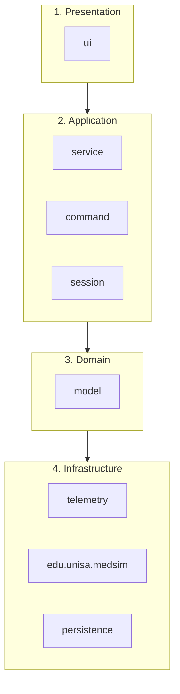

# Software Architecture

**Telerehab Session Manager**, Medical Software Engineering, a.y. 2026/27.
A JavaFX desktop application for clinicians to design rehabilitation protocols and run them
with simulated physiological telemetry (package `edu.unisa.medsim`).

This document describes the **planned** architecture and is updated at the end of each sprint.
Most classes named here are introduced during the sprints; at the Pre-Game only the packages
and the `edu.unisa.medsim` module exist.

## 1. Technology

| Choice | Motivation |
| --- | --- |
| Java 17, Maven | Required by the provided simulator, reproducible build on every machine |
| JavaFX 21 + FXML | Desktop UI with a clean view/controller separation |
| JUnit 5 | Automated unit tests (`mvn test`) |
| GitHub, Trello | Source control and Sprint Task Board |

## 2. Architecture

Layered architecture with MVC in the presentation layer.
Each layer uses only the layers below it (relaxed layering).

| Layer | Package | Responsibility |
| --- | --- | --- |
| 1. Presentation | `ui` | JavaFX views (FXML) and controllers, no business logic |
| 2. Application | `service` | Exercise catalog, protocol management |
| | `command` | Undo/redo commands (Command) |
| | `session` | Session execution, states (State), execution modes (Strategy) |
| 3. Domain | `model` | `Exercise`, `AnatomicalDistrict`, `TherapyProtocol`, session data |
| 4. Infrastructure | `telemetry` | `TelemetryProvider`, medsim adapter (Adapter), safety monitor |
| | `edu.unisa.medsim` | Provided simulator (refactored with Strategy in US-07) |
| | `persistence` | Save and load (Epic 4) |
| Entry point | `app` | `MainApp`, `Launcher` |

Base package of the application: `it.unisa.telerehab`.

**Upward notifications** (telemetry samples, state changes) use the Observer pattern
(`SessionListener`), never a direct call from the session to the UI.

**Shared type.** Only `telemetry` uses `PatientTelemetrySimulator`. `ClinicalProfile` is a shared
type from `edu.unisa.medsim`: it is the target profile of a `TherapyProtocol` and the UI lists
the available profiles through `ClinicalProfileRegistry`.

## 3. Design patterns

| Pattern | Where | Why |
| --- | --- | --- |
| Strategy | Clinical profiles (`ClinicalProfile`); execution modes (Sequential, Adaptive, Circuit) | Removes the OCP smell in medsim, so HYPERTENSIVE can be added without changing existing code; interchangeable execution algorithms |
| Simple Factory / Registry | `ClinicalProfileRegistry` | One place that lists the clinical profiles, the UI does not know the concrete classes |
| Adapter | `MedsimTelemetryProvider` implements `TelemetryProvider` | Isolates the provided simulator from the rest of the application, a fake provider can be used in tests |
| Observer | Session listeners (`SessionListener`), safety monitor, Session Monitor UI | Decouples telemetry and session logic from the UI |
| State | Session states (Idle, Running, Paused, Safety-Paused, Completed, Stopped) | Allowed actions depend on the current state |
| Command | Protocol modifications | Unlimited undo/redo with two stacks |
| Builder | `Exercise` | Many parameters (name, district, duration or repetitions, intensity, max safe HR), validation in one place |
| Composite | Therapy Modules | A module behaves as a single protocol item |
| Prototype | Duplicate exercise/module | Copy items without knowing their concrete class |

## 4. Shared interfaces

**Agreed in the Pre-Game (needed in Sprint 1):**

| Type | Content |
| --- | --- |
| `Exercise` | Immutable, created with a Builder. Fields: `id` (UUID), `name`, `district` (`AnatomicalDistrict`), `durationSeconds` **or** `targetRepetitions`, `intensity` (0..10), `maxSafeHeartRate` (BPM) |
| `AnatomicalDistrict` | `UPPER_LIMB`, `LOWER_LIMB`, `CORE`, `CARDIO` |
| `TherapyProtocol` | `name`, `targetProfile` (`ClinicalProfile`), ordered list of exercises with `addExercise`, `removeExercise`, `getExercises` |
| `ClinicalProfile` | Profile-specific parameters of the simulated patient |

Repetition-based exercises are simulated for `targetRepetitions × SECONDS_PER_REPETITION`
seconds, with `SECONDS_PER_REPETITION = 3` (team assumption).

**Planned, to be finalized in the Sprint 2 planning:**

| Type | Content |
| --- | --- |
| `TelemetryProvider` | `next(deltaSeconds, intensity, resting)`, `reset()` |
| `SessionListener` | `onSample(...)`, `onStateChanged(...)`, `onExerciseChanged(...)` |
| `SessionStateType` | Session states |

## 5. Refactoring of edu.unisa.medsim

**Smell.** `PatientTelemetrySimulator` uses a `switch (profileType)` in `step()` and in the default
baseline methods. Every new profile forces a modification of the class, violating the
Open/Closed Principle.

**Solution (US-07, US-08).**

- Introduce a `ClinicalProfile` interface exposing the profile-specific parameters (baseline HR and
  SpO2, HR and SpO2 gains, adaptation rates, fatigue rate, noise amplitude).
- The existing `ClinicalProfileType` enum implements `ClinicalProfile`, so the provided test and
  demo stay unchanged.
- `PatientTelemetrySimulator` receives a `ClinicalProfile` and delegates to it; the shared logic
  (exponential adaptation, noise, hypoxia penalty, pain score, perturbed sessions) stays in the
  simulator.
- The new `HypertensiveProfile` is a separate class, added without modifying the simulator;
  a simple factory/registry lists the available profiles.

**Safety net.** The existing `PatientTelemetrySimulatorTest`, plus characterization tests written
before the change, must stay green before and after the refactoring, so that the behavior is
preserved. New tests cover `HypertensiveProfile`.
